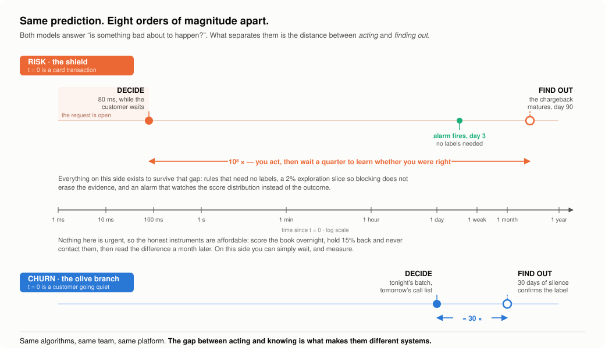
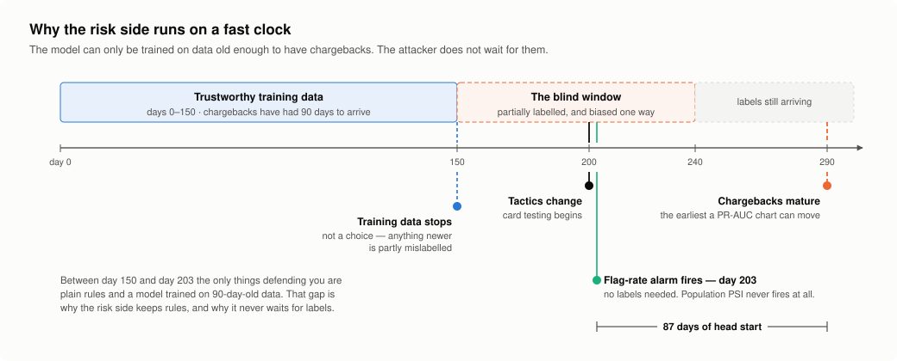
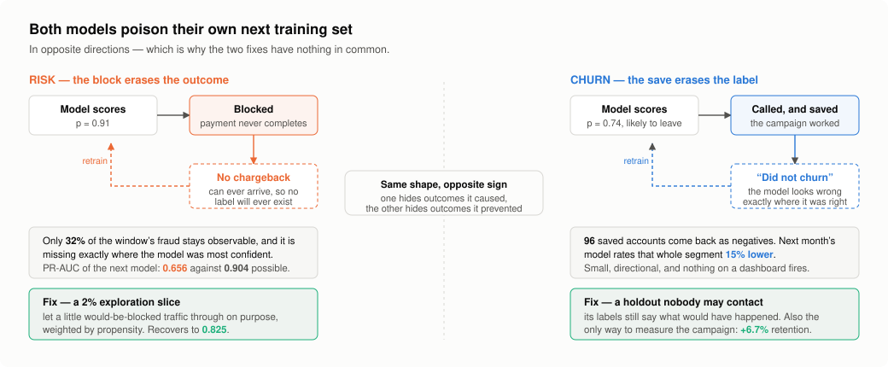

<div align="center">

# Churn vs Risk

**Two production ML pipelines, built end to end — and every claim about them checked.**

Companion code for **[Why Your Churn Model Is Not a Risk Model (And Why It Matters)](https://medium.com/ai-that-ships/why-your-churn-model-is-not-a-risk-model-and-why-it-matters-963e1f9bd2e9)**

[](https://github.com/santoshshinde2012/churn-vs-risk-poc/actions/workflows/ci.yml)
[](https://www.python.org/)
[](LICENSE)
[](docs/claims.md)

[Read the article](https://medium.com/ai-that-ships/why-your-churn-model-is-not-a-risk-model-and-why-it-matters-963e1f9bd2e9) ·
[Getting started](docs/getting-started.md) ·
[The pipelines](docs/pipelines.md) ·
[Findings](docs/findings.md) ·
[Architecture](docs/architecture.md) ·
[Claims ledger](docs/claims.md)

</div>

---

The article argues that churn prediction and fraud prediction are different jobs that need
different pipelines. This repo builds both, end to end, and **checks** the claims instead of
restating them.

Three of them did not survive contact with the data. They are written up as
[findings](docs/findings.md) rather than quietly rounded away.

Everything runs locally in about a minute. No cloud account, no credentials, no network
access, no personal data.

```bash
./setup.sh                      # CPython 3.10-3.13; picks one for you
.venv/bin/python run_all.py     # tests, five pipelines, ledger, dashboard
```

---

## The thesis, in one picture



Both pipelines on one logarithmic time axis. Risk has to decide in **80 ms** and does not
find out whether it was right for **90 days** — a gap of eight orders of magnitude, spanning
almost the whole chart. Churn decides overnight and knows a month later.

That gap is the whole argument. It is why one side needs rules, an exploration budget and an
alarm that never waits for labels, while the other can simply wait and measure.

---

## The claims ledger

Most companion repos assert. This one keeps a **traceability matrix**: every claim in the
article is registered in [`docs/claims.yaml`](docs/claims.yaml) with a verdict and a pointer
to the exact metric that settles it.

```yaml
- id: CST-01
  article_claim: >-
    Set the threshold in dollars. Blocking a good customer costs $500 and a
    missed fraud costs $150, so block when p > 0.77. Not 0.5.
  verdict: contradicted
  tested_by: 02_risk_realtime_pipeline.py
  evidence:
    - metric: risk_metrics.json#threshold.cost_at_derived
      expect: {min: 15000}
      reads: "blocking at 0.77 costs $19,100 over the test window"
```

`scripts/verify_claims.py` resolves all **67 measurements** against a real run, on every
commit. A claim in these docs cannot quietly become untrue — if a seed moves or a threshold
changes, CI fails and names the claim that broke.

| | Verdict | Count | Meaning |
| :-- | :--- | ---: | :--- |
| 🟢 | Confirmed | 20 | The run supports the claim as stated |
| 🟡 | Qualified | 3 | Supported, with a caveat that changes what you do |
| 🔴 | Contradicted | 2 | The run does not support it — see [findings](docs/findings.md) |
| 🔵 | Demonstrated | 3 | An engineering practice shown working |

**[Read the full ledger →](docs/claims.md)**

---

## What a run shows

<table>
<tr><th align="left">The article says</th><th align="left">What a run shows</th></tr>
<tr><td>The churn label is a window you choose</td>
<td>A 7-day window calls <b>53%</b> of its "churners" wrong. A 60-day window is clean and confirms too late to act.</td></tr>
<tr><td>Fraud labels arrive 30–90 days late</td>
<td>On day 240 only <b>959 of 1,420</b> actual frauds have a chargeback on file.</td></tr>
<tr><td>Point-in-time features, or else</td>
<td>A leaky model scores <b>0.904</b> offline and <b>0.470</b> on real features.</td></tr>
<tr><td>Never validate on a shuffled split</td>
<td>Same held-out rows: shuffled <b>0.988</b>, time-split <b>0.877</b>.</td></tr>
<tr><td>The threshold is in dollars, not 0.5</td>
<td>🔴 0.77 from the costs — <b>and it loses to 0.5 on measured costs.</b></td></tr>
<tr><td>Blocking destroys your next training set</td>
<td><b>68%</b> of the window's fraud labels erased. A 2% exploration slice recovers most of it.</td></tr>
<tr><td>Retention calls erase labels too</td>
<td>96 saved accounts return as negatives; the next model rates them <b>15% lower</b>.</td></tr>
<tr><td>Uplift modelling is the next step</td>
<td>🔴 As a <b>ranker</b> it loses to the risk score. As a <b>screen</b> it wins by 14%.</td></tr>
<tr><td>Fraud monitors on a fast clock</td>
<td>🟡 Population PSI never fires. The flag rate catches it in <b>3 days</b>, 87 days before the labels.</td></tr>
</table>

---

## Why the fraud side is different



The model can only be trained on data old enough to have chargebacks. The attacker does not
wait for them. Everything else on that side — rules beside the model, an exploration slice,
a label-free alarm — falls out of that 87-day gap.

---

## The part nobody demos



Both models act on their own predictions, and both damage the data they would retrain on.
The article calls this the section almost nobody talks about;
[`04_feedback_loops.py`](04_feedback_loops.py) measures both sides and both fixes.

---

## What's in the box

| | |
| :--- | :--- |
| **5 pipeline scripts** | Churn batch · risk real-time · live serving with an outage · feedback loops · monitoring |
| **Part A notebook** | Plain Jupyter, plain sklearn, no repo imports. Ships with its outputs |
| **Part B notebook** | The same two pipelines on Databricks, Free-Edition runnable |
| **`churnrisk/`** | Metrics, drift, policy, rules, registry, inference log, data generators |
| **`policies/*.yaml`** | The decision layer — versioned, and outside the model |
| **49 tests** | Guarding leakage, holdout stability and policy validation |
| **Claims ledger** | 28 claims, 67 measurements, verified in CI |
| **HTML dashboard** | `outputs/dashboard.html` — self-contained, shareable, regenerated each run |

**[Full walkthrough with every figure →](docs/pipelines.md)**

---

## Documentation

| | |
| :--- | :--- |
| [Getting started](docs/getting-started.md) | Install, run, troubleshoot, extend |
| [The pipelines](docs/pipelines.md) | All five scripts, with output and figures |
| [Findings](docs/findings.md) | The three places the results argue with the article |
| [Architecture](docs/architecture.md) | Design decisions, and why each one is load-bearing |
| [Claims ledger](docs/claims.md) | The traceability matrix, generated and verified |
| [Sample run](docs/sample_run.txt) | The complete console output of a real run, committed |

A searchable site is available via `mkdocs serve` — see [`mkdocs.yml`](mkdocs.yml). The
Markdown under `docs/` is the source of truth and renders correctly on GitHub without it.

---

## Contributing

Issues and pull requests are welcome — especially
[challenges to a finding](.github/ISSUE_TEMPLATE/finding_challenge.yml). Three of the
article's claims are contradicted or qualified by this code, and any of them could be wrong
in turn.

One rule catches people out: **if your change moves a number, the docs move with it in the
same commit.** [`CONTRIBUTING.md`](CONTRIBUTING.md) explains how the ledger makes that
automatic rather than a matter of care.

---

## Citing

If this is useful in a talk or a paper, [`CITATION.cff`](CITATION.cff) has the metadata, and
GitHub renders a "Cite this repository" button from it.

## License

[Apache-2.0](LICENSE). Third-party content and referenced work are listed in
[NOTICE](NOTICE).
