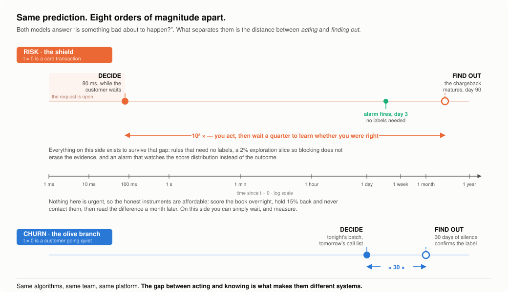

# Architecture and design decisions

The decisions on this page are load-bearing rather than stylistic. Each one is here because
getting it wrong the other way produced a measurably worse result somewhere in this repo,
and most of them are pinned by a test.



Every decision below follows from that picture: the further apart *acting* and *knowing* sit,
the more machinery you need to survive the space between them.

---

## Module map

The pipeline scripts are meant to be read top to bottom, so anything that would be
scaffolding in them lives in `churnrisk/` instead.

| Module | Responsibility |
| :--- | :--- |
| [`config.py`](https://github.com/santoshshinde2012/churn-vs-risk-poc/blob/main/churnrisk/config.py) | Every constant worth changing, in one place |
| [`churn_data.py`](https://github.com/santoshshinde2012/churn-vs-risk-poc/blob/main/churnrisk/churn_data.py) | Simulated engagement history; as-of feature slices; label windows |
| [`risk_data.py`](https://github.com/santoshshinde2012/churn-vs-risk-poc/blob/main/churnrisk/risk_data.py) | Simulated card stream with rings and chargeback delays; single-pass features |
| [`metrics.py`](https://github.com/santoshshinde2012/churn-vs-risk-poc/blob/main/churnrisk/metrics.py) | Imbalance-safe metrics; Brier, ECE, reliability curves; cost curves |
| [`drift.py`](https://github.com/santoshshinde2012/churn-vs-risk-poc/blob/main/churnrisk/drift.py) | PSI, KS, the precomputed-bin `Monitor`, the flag-rate z-score |
| [`policy.py`](https://github.com/santoshshinde2012/churn-vs-risk-poc/blob/main/churnrisk/policy.py) | The versioned decision layer, loaded and validated from YAML |
| [`rules.py`](https://github.com/santoshshinde2012/churn-vs-risk-poc/blob/main/churnrisk/rules.py) | Plain detectors that run beside the model; escalate-only combination |
| [`holdout.py`](https://github.com/santoshshinde2012/churn-vs-risk-poc/blob/main/churnrisk/holdout.py) | Stable, hash-based control-group assignment |
| [`registry.py`](https://github.com/santoshshinde2012/churn-vs-risk-poc/blob/main/churnrisk/registry.py) | MLflow tracking and guarded `@champion` promotion |
| [`inference_log.py`](https://github.com/santoshshinde2012/churn-vs-risk-poc/blob/main/churnrisk/inference_log.py) | The local stand-in for inference tables |
| [`viz.py`](https://github.com/santoshshinde2012/churn-vs-risk-poc/blob/main/churnrisk/viz.py) | One plot style for every figure |

---

## The decision layer is not the model

**Bands, costs, timeouts and fail modes live in [`policies/*.yaml`](https://github.com/santoshshinde2012/churn-vs-risk-poc/blob/main/policies) and are
loaded at decision time.** The model returns a probability and nothing else.

The block threshold is *derived* from the costs rather than typed in:

```yaml
costs:
  false_positive: 500     # blocking a good customer: lost lifetime value
  false_negative: 150     # missing a fraud: chargeback plus fees
```

```python
@property
def act_threshold(self) -> float:
    return fp / (fp + fn)          # 0.77, and it moves when the costs move
```

So a cost change moves the threshold automatically, and the number in the config can never
drift from the arithmetic. The first version of this POC pickled the bands *inside the model
artifact*, which meant a threshold change shipped a model — exactly the coupling the
separation is supposed to prevent.

[Script 03](pipelines.md#the-policy-swaps-the-model-does-not) replays 279,030 stored scores
through v1 and v2 to show the decision mix moving with no retraining and no redeploy.

Two supporting details:

- **The policy version is on every inference-log row.** When the block rate jumps overnight,
  the first question is whether the model or the policy changed, and the log answers it
  without anyone guessing.
- **The loader validates.** A band at or above the derived block threshold can never fire,
  so `load_policy` refuses it rather than shipping a config that quietly lies. Same for
  out-of-range probabilities and unknown fail modes. See
  [`tests/test_policy_and_rules.py`](https://github.com/santoshshinde2012/churn-vs-risk-poc/blob/main/tests/test_policy_and_rules.py).

### Two kinds of policy

The two sides decide differently, so the loader models both:

| Kind | Used by | Behaviour |
| :--- | :--- | :--- |
| `blocking` | risk | Above the cost-derived threshold the action is refused. Bands underneath hand off to cheaper interventions. |
| `tiered` | churn | Nothing is ever refused. Higher scores buy a more expensive contact, and capacity binds long before the threshold does. |

---

## Rules beside the model

Plain detectors — velocity limits, a device blocklist, a new-account amount ceiling, a
shared-device count — run alongside the model and **can only escalate**. A rule that
misfires costs friction; it can never wave a high-scoring event through.

```python
def apply(self, model_action, record):
    action = model_action
    for hit in self.evaluate(record):
        action = escalate(action, hit.action)   # moves right, never left
    return action, hits
```

They exist for two reasons the measurements support:

1. **They need no labels**, so they do not care that trustworthy training data stops 90 days
   ago. On the drift week the rules alone touch 17% of fraud with no model involved.
2. **They need no endpoint**, so they keep working when scoring does not. During the
   simulated outage in [script 03](pipelines.md#03-serving-with-an-outage), a rule caught a
   fraudulent request with no model in the loop at all.

### The blocklist is devices only — and only *some* devices

This is one line of configuration that moves the insult rate by two orders of magnitude, so
it is worth stating why.

| Naive rule | What it does | Insult rate |
| :--- | :--- | ---: |
| Blocklist cards with confirmed fraud | Punishes the victim for having been defrauded. Every later transaction from that customer is a false decline. | 3.9% |
| Blocklist devices with confirmed fraud | A session hijack happens on the customer's own laptop. Same mistake, different hat. | >1% |
| **Devices with ≥2 frauds *and* ≥90% fraud share** | Keeps the attacker's throwaway devices and the ring's shared handsets; leaves the victim's hardware alone. | **0.006%** |

Both failure modes are pinned by
[`test_blocklist_spares_devices_with_a_legitimate_history`](https://github.com/santoshshinde2012/churn-vs-risk-poc/blob/main/tests/test_policy_and_rules.py).

---

## Point-in-time correctness is structural, not trusted

This is the invariant most worth testing, because breaking it makes your offline metrics
look **better**. Nothing about a leak announces itself.

Two mechanisms, one guarantee:

- **Risk** — a single pass over the sorted stream that reads features out of state
  containing only rows `0..i-1`, and updates that state only *after* row `i` has been
  scored. That is the same guarantee an online feature store gives at serving time, which is
  the whole reason to build training features this way rather than with a group-by over the
  finished table.
- **Churn** — array slices that stop at the snapshot, so there is no future column available
  to leak even by accident.

[`tests/test_point_in_time.py`](https://github.com/santoshshinde2012/churn-vs-risk-poc/blob/main/tests/test_point_in_time.py) re-runs both builds on
truncated inputs and asserts every shared row is identical, plus the boundary conditions: an
account's first transaction has no history, and the first event on a device counts zero
prior accounts.

The cost of getting it wrong is measured, not asserted: a leaky churn model scores 0.904
offline and [0.470 on real features](pipelines.md#point-in-time-features).

---

## The holdout is a hash, not a random draw

```python
bucket = int(md5(f"{salt}:{entity_id}").hexdigest()[:8], 16) % 10_000
in_holdout = bucket < share * 10_000
```

Membership is a property of the customer, so it survives row reordering, population growth,
pipeline rewrites and language changes, and needs no state anywhere.

A per-run random draw reshuffles the holdout whenever the row order or the population
changes, and a holdout that moves measures nothing: last month's control group becomes this
month's treated group, and the difference between them is noise plus a reshuffle.

`salt` is effectively a version number. Changing it re-draws the whole holdout, which is
occasionally what you want and never what you want by accident.

### Two control groups, doing two different jobs

| | Size | Job |
| :--- | :--- | :--- |
| **Standing holdout** | 15%, permanent | Measure whether the programme works at all. Deliberately small — every account in it is one nobody is allowed to help. |
| **Randomised test** | 50/50, three months | Estimate *who* responds. A much harder question, and 15% of an eligible slice cannot answer it. |

That second cost is real and deliberate, and it is the price of a targeting rule. See
[finding 2](findings.md#2-uplift-modelling-works-as-a-screen-not-as-a-ranker) for what it
buys and what it does not.

---

## MLflow is real MLflow

`outputs/mlruns` is a file-backed MLflow tracking store and model registry. The promotion
pattern in this repo is the promotion pattern you would ship:

```python
registry.log_model(model, "ml.churn.scorer", params, metrics)
registry.promote("ml.churn.scorer", version, metric="pr_auc", value=pr_auc)
model = registry.load("ml.churn.scorer")        # models:/ml.churn.scorer@champion
```

**Promotion is guarded.** `@champion` only moves if the candidate beats the incumbent on the
tracked metric, read back from the run that produced it so the comparison survives across
processes. "We retrained, therefore we shipped" is how a pipeline quietly regresses for a
quarter. Losing candidates are parked as `@challenger` rather than discarded.

Batch jobs and the serving endpoint both load **by alias**, never by version, so a promotion
changes what runs tonight without editing the job.

---

## The inference log

Every scored request is written with the model version, the policy version, the action the
model proposed, the action actually taken, which rules fired, and latency — and, at request
time, **no outcome**.

That last part is the point. On the risk side the outcome arrives months later and gets
joined in then, which is where [selective labels](pipelines.md#risk-blocking-erases-the-outcome)
becomes visible. The log is what makes four things possible:

- recomputing the decision threshold from measured costs instead of guesses
- reconstructing the next training set with the decisions attached
- attributing a shift in the decision mix to a policy version
- monitoring score drift without waiting for labels

On Databricks this is inference tables on a serving endpoint, which give you the same table
for free.

---

## Simulated data, and why

The engagement history and the transaction stream are both generated with fixed seeds, so
the repo ships no personal data.

They are simulations because the claims need things no public dataset has: a time axis,
chargeback filing delays, fraud rings that share devices, cold-start accounts, and known
counterfactual outcomes for every customer. Without counterfactuals there is no way to score
a targeting policy at all.

The honest limitations, stated once:

- **The generators encode the effects they demonstrate.** Reachability decays with decline,
  so of course targeting-by-reachability wins. What the POC tests is not *whether* these
  effects exist in the world — that is what Ascarza and Lakkaraju are for — but whether the
  proposed *methods* recover them from realistic data at realistic sample sizes. Two of them
  do not, which is the interesting part.
- **Every constant is visible.** They are in [`config.py`](https://github.com/santoshshinde2012/churn-vs-risk-poc/blob/main/churnrisk/config.py) and in the
  module docstrings, not buried in a notebook cell.
- **The metric story is cross-checked on real data.** `data/telco_churn.csv` (the public IBM
  sample) runs through the same recipe at the end of script 01.

---

## Mapping to Databricks

[`part_b_databricks.py`](https://github.com/santoshshinde2012/churn-vs-risk-poc/blob/main/part_b_databricks.py) is a runnable notebook. Every local
stand-in in this repo exists because something on the platform does the job properly:

| In this repo | On Databricks |
| :--- | :--- |
| `churn_data.build_features` (as-of slices) | time series feature table + `create_training_set` |
| `risk_data.build_features` (single pass) | Structured Streaming + Online Feature Store |
| `outputs/mlruns` | MLflow tracking + Unity Catalog registered models |
| `registry.promote` | UC model aliases (`@champion`) |
| `inference_log.py` | inference tables on a serving endpoint |
| `policies/*.yaml` | a versioned Delta policy table |
| `drift.py` | Lakehouse Monitoring, plus a flag-rate query |
| Script 03's HTTP server | Mosaic AI Model Serving, route-optimized |

Keep the paths separate. Mixing them adds latency to the side that does not need it and
gives the side that does a jumpy, untrusted score. One governance layer, two pipelines, no
shared serving path.
