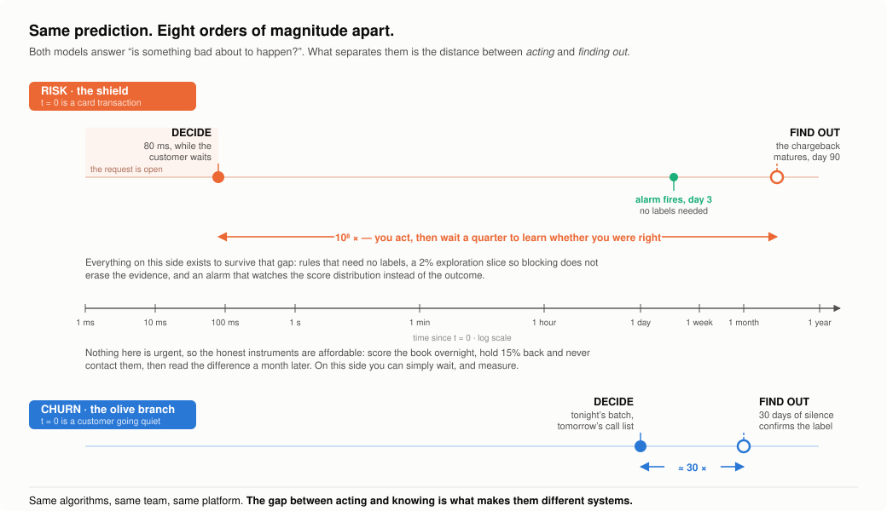

# Churn vs Risk

**Two production ML pipelines, built end to end — and every claim about them checked.**

Companion code for **[Why Your Churn Model Is Not a Risk Model (And Why It Matters)](https://medium.com/ai-that-ships/why-your-churn-model-is-not-a-risk-model-and-why-it-matters-963e1f9bd2e9)**.

The article argues that churn prediction and fraud prediction are different jobs that need
different pipelines. This project builds both and **checks** the claims instead of restating
them. Three of them did not survive contact with the data; they are written up in
[Findings](findings.md).

Risk decides in 80 ms and finds out 90 days later. Churn decides overnight and finds out in
a month. The distance between acting and knowing is what forces the two systems apart.

---

## Start here

- **[The article](https://medium.com/ai-that-ships/why-your-churn-model-is-not-a-risk-model-and-why-it-matters-963e1f9bd2e9)**

    The piece this project accompanies, published on Medium.

- **[Getting started](getting-started.md)**

    Install and run in about a minute. No cloud account, no credentials, no network.

- **[The pipelines](pipelines.md)**

    All five scripts, with their real output and every figure.

- **[Findings](findings.md)**

    The three places the results argue with the article, and what to do instead.

- **[Architecture](architecture.md)**

    Design decisions, and why each one is load-bearing rather than stylistic.

- **[Claims ledger](claims.md)**

    28 claims, 67 measurements, verified against a real run on every commit.

- **[Sample run](sample_run.md)**

    The complete console output, committed, for reading without running anything.

---

## Why there is a claims ledger

Documentation that quotes numbers rots, and it rots silently: the code keeps running, the
prose just stops being true.

Every claim in the article is registered in
[`claims.yaml`](https://github.com/santoshshinde2012/churn-vs-risk-poc/blob/main/docs/claims.yaml)
with a verdict and a pointer to the metric that settles it. CI resolves all 67 pointers
against a real run, so a claim in these pages cannot quietly become untrue.

| | Verdict | Count |
| :-- | :--- | ---: |
| 🟢 | Confirmed | 20 |
| 🟡 | Qualified | 3 |
| 🔴 | Contradicted | 2 |
| 🔵 | Demonstrated | 3 |

The five non-confirmed verdicts are the reason it exists. A companion repo that agrees with
its article about everything has not been run.
