# The pipelines, end to end

Five scripts. Run them in order the first time — 03, 04 and 05 read artifacts that 01 and
02 write. Every number on this page comes from `outputs/metrics/*.json` and is enforced by
[the claims ledger](claims.md).

| | | Runtime |
| :--- | :--- | ---: |
| [01](#01-churn-the-batch-path) | Churn, the batch path | ~14 s |
| [02](#02-risk-the-real-time-path) | Risk, the real-time path | ~11 s |
| [03](#03-serving-with-an-outage) | Serving, with an outage | ~5 s |
| [04](#04-feedback-loops) | Feedback loops | ~10 s |
| [05](#05-monitoring-on-two-clocks) | Monitoring on two clocks | ~6 s |

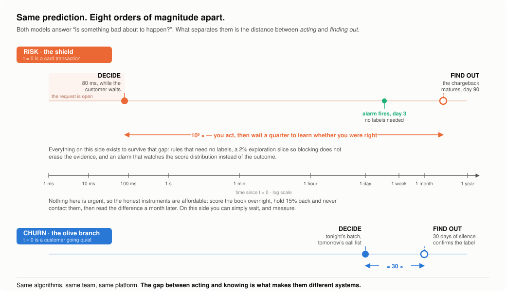

---

## 01. Churn, the batch path

```bash
.venv/bin/python 01_churn_batch_pipeline.py
```

20,000 simulated SaaS accounts over 240 days. The simulation exists because the IBM Telco
dataset — which the first version of this POC used — is a **snapshot with no time axis**,
and four of the article's churn claims need to know when things happened. Telco is still in
the pipeline, at the end, as a real-data check that the metric story holds on data nobody
made up: PR-AUC 0.648 against a 0.265 base rate, precision@200 of 76%.

The simulated book churns at **5.4%** per 30-day window, inside the 2–5% the article quotes
for this kind of business.

### The label is a window you choose

Not a fact about the world. The same book, four windows:

```
 window_days  labelled_churned  churn_rate  came_back_later  false_alarm_share
           7              1623       0.096              864              0.532
          14              1157       0.068              398              0.344
          30               863       0.051              104              0.121
          60               778       0.046               19              0.024
```

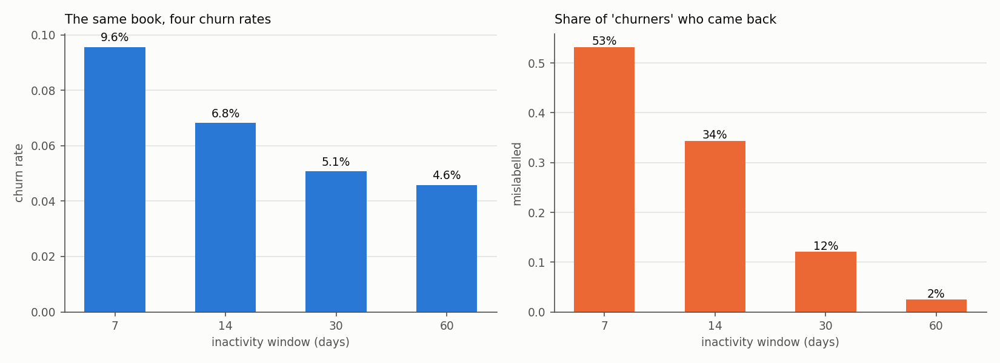

A 7-day window is more than half wrong — those are people on holiday, not people leaving. A
60-day window is clean and confirms two months after the account went quiet, which is far
too late to call anyone. The pipeline uses 30. It is a trade, not a truth, and the trade is
worth making explicitly rather than by default.

### Point-in-time features

The leaky variant here is not a straw man. It is what you get when the feature job runs on a
lag and aggregates "the last 30 days" as of the day it happens to run, rather than as of the
day each label was decided.

```
PR-AUC of the leaky model, scored on leaky features:  0.904  <- the demo
PR-AUC of the leaky model, scored on real features:   0.470  <- production
PR-AUC of the point-in-time model:                    0.742
```

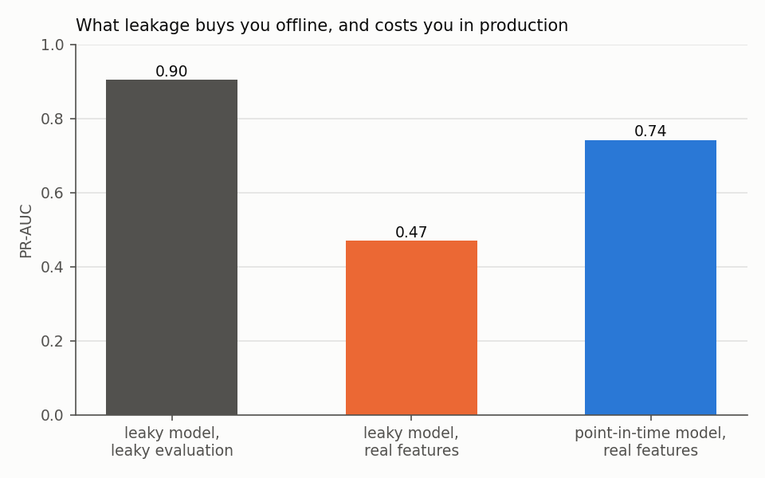

The leaky model looks like the best thing anyone ever built, right up until it is asked a
question about the future.

In this repo the guarantee is structural rather than trusted: every array slice in
`churn_data.build_features` stops at the snapshot, so there is no future column available to
leak even by accident. `tests/test_point_in_time.py` re-runs the build on a truncated
history and asserts every shared row is identical. On Databricks the same guarantee comes
from declaring the feature table a time series and letting `create_training_set` do the
as-of join — see [`part_b_databricks.py`](https://github.com/santoshshinde2012/churn-vs-risk-poc/blob/main/part_b_databricks.py).

### Cold start

3.4% of the day-200 book is younger than the feature windows. Their rolling aggregates are
borrowed from their plan cohort and **flagged as borrowed**. The flag matters more than the
fill: without it the model cannot tell a brand-new account from a departing one, because
both have zero actions in the last 90 days for opposite reasons.

The model is much weaker on them, and the script says so. Do not pretend a cold account has
a reliable score; route it by cohort rules until it has a history.

The risk side has the mirror-image problem, and it is worse: see
[cold start on the risk side](#cold-start-the-mirror-image).

### Metrics, and whether the probabilities are real

```
PR-AUC 0.742   (random = the base rate, 0.054, so 13.7x)
ROC-AUC 0.979  <- flattering: with a negative class this large, hundreds of
                  false positives barely move the false positive rate
Brier 0.0233   ECE 0.0036
precision@200 88.0%   recall@200 19.5%   (random: 5.4%)
```

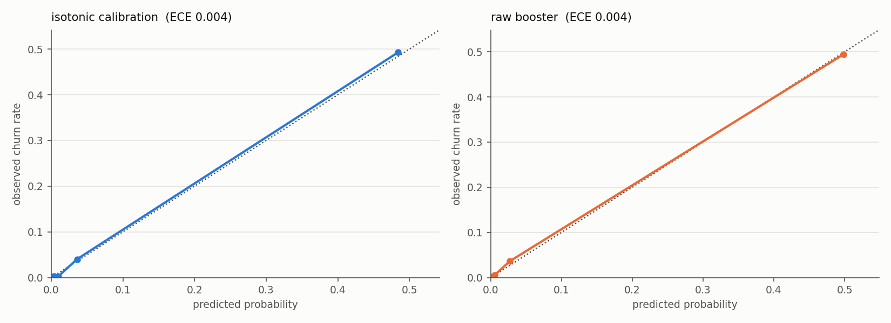

Isotonic calibration is applied because the decision layer reads the score as a probability,
and the script *measures* whether it is one rather than assuming it. Precision at *k* is
reported against the number of calls the team can actually make:

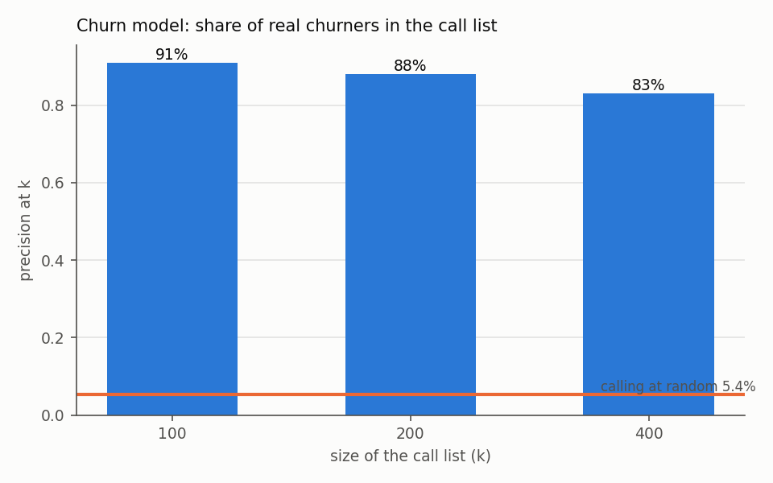

### The nightly batch

Scores the day-200 book out of sample, assigns a 15% holdout by hashing the account id,
writes a 200-name call list, registers the model, takes the `@champion` alias, and logs all
16,730 scored rows to the inference log.

The holdout is excluded on purpose and it hurts on purpose — those are real churners nobody
will call. [Script 04](#04-feedback-loops) spends it.

One line worth pausing on: **2,527 accounts clear the cost-derived contact threshold and the
team can make 200 calls.** Losing a customer costs so much more than a phone call that the
economics say contact almost everyone, so capacity — not the threshold — is the binding
constraint. That is why the churn side reports precision at *k* rather than a confusion
matrix at 0.5.

---

## 02. Risk, the real-time path

```bash
.venv/bin/python 02_risk_realtime_pipeline.py
```

279,030 simulated card transactions over 240 days, **0.51% fraud**, in three patterns:

| Pattern | What it looks like |
| :--- | :--- |
| **takeover** | A real account, usually a new device and a foreign country. 30% are session hijacks on the customer's own device in their home country, which no feature set separates. That is the ceiling on how good any model here can be, and every real fraud dataset has them. |
| **ring** | Mule accounts opened in batches sharing a small pool of devices and cards. Nothing about any single account looks unusual; the sharing is the tell, and only a network feature can see it. |
| **card_testing** | The tactic change, from day 200. Local country, tiny amounts, very high velocity. The model has never seen it. |

### Label maturation is the binding constraint

This is the part most pipelines get wrong silently.

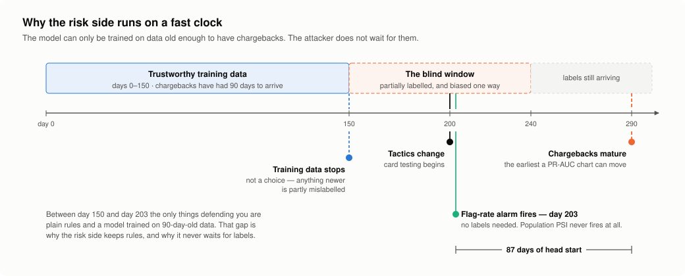

```
  23.0% of chargebacks have landed  30 days after the transaction
  68.7% of chargebacks have landed  60 days after the transaction
  89.3% of chargebacks have landed  90 days after the transaction

today is day 240. of 1,420 transactions that really were fraud, 959
have a chargeback on file. the other 461 read as legitimate right now.
```

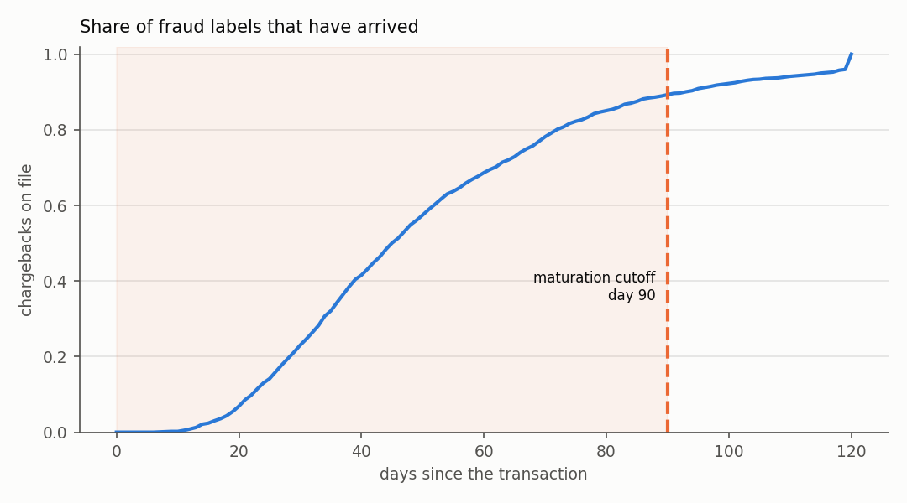

`is_fraud = 0` on a recent row does not mean "legitimate". It means "not yet" — and that is
not a missing value a pipeline can notice, it is a wrong one it will happily train on. Three
training sets, all scored on the drift week against what really happened:

| | PR-AUC | |
| :--- | ---: | :--- |
| **A** — matured labels only, everything to day 150 | 0.855 | the model you could actually build today |
| **B** — all rows to day 200, labels as they look today | 0.885 | what happens when nobody thinks about it |
| **C** — all rows to day 200, labels from the future | 0.909 | impossible |

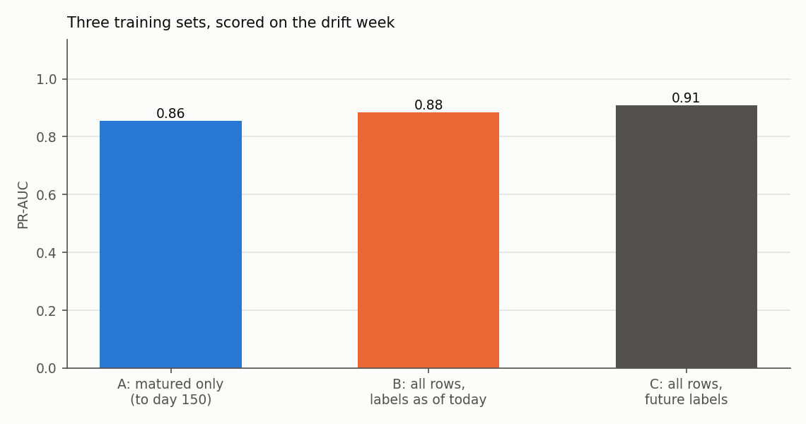

**B minus C is the cost of the missing labels alone** — same rows, same recipe, same volume.
The only difference is that B trained on 103 frauds labelled legitimate because their
chargebacks had not arrived.

**A minus C is the cost of being stale.** A is the honest choice and it is still 90 days
behind the attack. No drift chart fixes that; rules cover the gap.

### Out of time, never shuffled

Both models scored on the same 21,034 held-out drift-week rows:

```
  shuffled split, trained on a random 60% of everything: 0.988
  time split, trained on matured data to day 150:        0.877
```

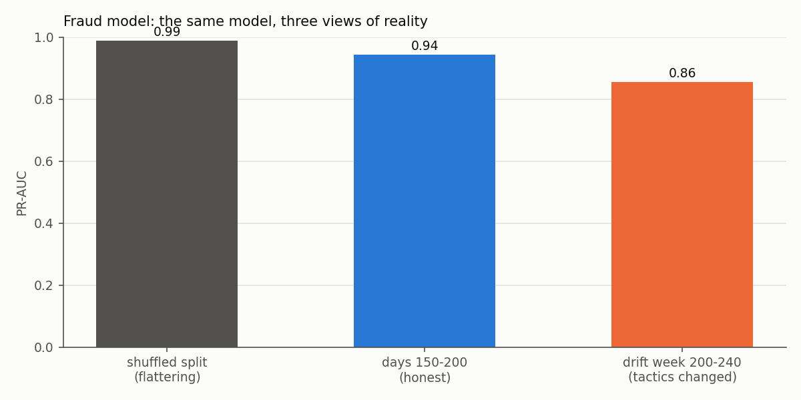

The shuffled model looks 0.11 better and has learned nothing extra. Its training set
contained 60% of the card-testing bursts, so it is being asked to recognise the second half
of an attack whose first half it memorised — and there is no version of production in which
that data was available.

### The threshold is in dollars

Read from [`policies/risk_policy_v1.yaml`](https://github.com/santoshshinde2012/churn-vs-risk-poc/blob/main/policies/risk_policy_v1.yaml) and *derived*
from the costs, never typed in:

```
from the policy file: block when p > 0.77   (FP $500 vs FN $150)
  cost at the derived threshold 0.77:  $    19,100
  cost at the default           0.50:  $    14,950
  cost at the measured minimum  0.38:  $    12,800
```

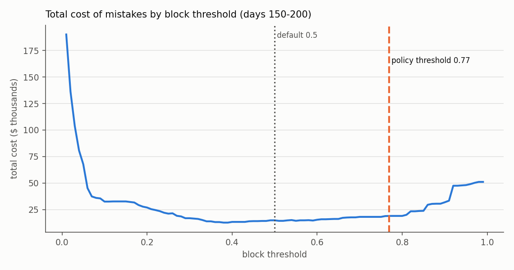

Calibration is measured on both windows, because it decays with everything else and the
threshold is arithmetic on these probabilities:

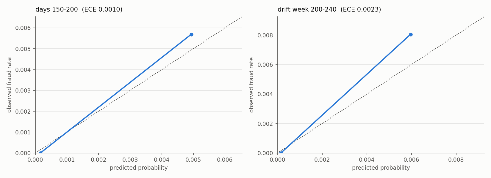

**This result argues with the article.** See
[finding 1](findings.md#1-the-dollar-threshold-is-a-starting-point-not-an-answer).

### Bands, and the rules beside them

The insult rate at the block threshold is **0.006%** — four legitimate transactions in
62,000 — which is the number the article's whole insult-rate argument depends on. The bands
underneath exist because the block threshold has to stay that high, which leaves real fraud
below it that still needs handling.

Plain rules run beside the model and **can only escalate**, never downgrade, so a misfiring
rule costs friction but can never wave a high-scoring event through.

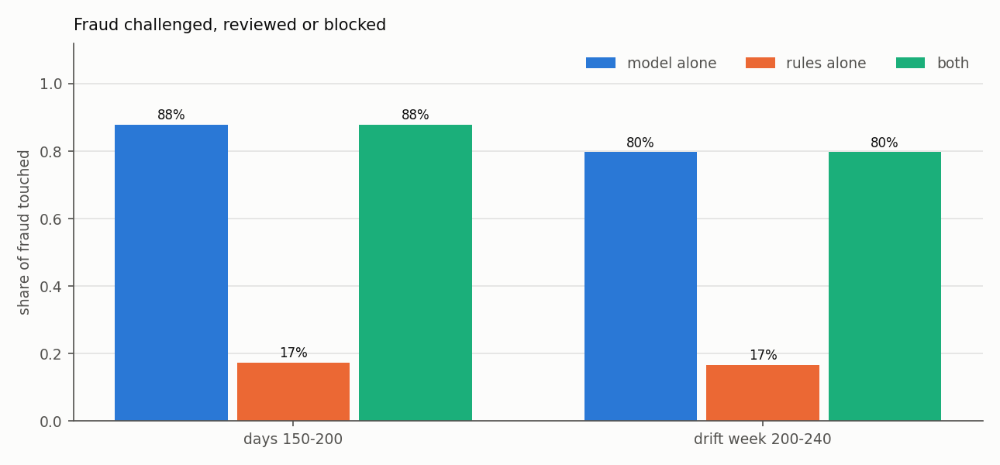

With no model at all the rules alone touch 17% of the drift week's fraud, and they add 0
incremental catches on top of a working model. That is the honest result, and it is not the
argument for keeping them. The argument is that they need no labels, so they do not care
that training data stops on day 150, and they need no endpoint, so they keep working when
scoring does not. [Script 03](#03-serving-with-an-outage) runs that second case.

### Cold start, the mirror image

Transactions from accounts under 30 days old are 3.6% of the window and carry a **nearly
16x** higher fraud rate (7.02% versus 0.44%). On the churn side a new account is merely
unknown. Here it is the highest-risk segment there is, and the one with the least history to
score on — so the compensating controls in the policy do the work: an amount ceiling, device
and network signals, stricter defaults, until the account has a past worth reading.

---

## 03. Serving, with an outage

```bash
.venv/bin/python 03_live_scoring_demo.py
```

A real `ThreadingHTTPServer` holding the model that 02 promoted to `@champion`, loaded **by
alias** (`models:/ml.risk.scorer@champion`) rather than by file path, so a promotion changes
what serves with no code change. Requests go through it the way an application would, with a
hard timeout read from the policy file.

```
  # action_type      decision    p(fraud)   latency truth  note
  1 login            BLOCK          0.851    43.3ms FRAUD
  3 login            CHALLENGE      0.569     8.6ms FRAUD
...
--------------------------------------------------------------------------------
... the scoring endpoint stops answering here (simulated outage) ...
--------------------------------------------------------------------------------
 25 checkout         ALLOW             --    87.5ms FRAUD  fail open (checkout): flagged for async review
 28 withdrawal       CHALLENGE         --    83.9ms FRAUD  fail closed (withdrawal): step-up verification
```

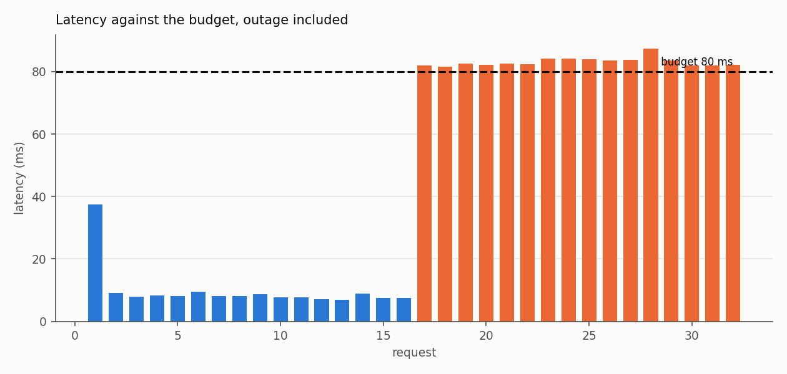

- **Healthy** — p50 8.1 ms, p95 18.2 ms, against an 80 ms budget that includes a simulated
  online-feature-store lookup.
- **Outage** — every call gives up at the budget. The timeout is the point: without one the
  library waits as long as the endpoint wants, and a scoring outage becomes a checkout
  outage.
- **Checkout and login fail open**, allowed and flagged for asynchronous review. **Three
  irreversible actions failed closed** and demanded verification instead. One fraudulent
  request during the outage was still caught by a rule, with no model in the loop at all.

### The policy swaps, the model does not

[`risk_policy_v2.yaml`](https://github.com/santoshshinde2012/churn-vs-risk-poc/blob/main/policies/risk_policy_v2.yaml) differs only in that finance
re-measured the cost of a false decline ($500 → $320) and chargeback fees rose ($150 → $180).
The threshold moves on its own, because it is derived rather than typed in:

```
v1.0.0: block >= 0.77   v2.0.0: block >= 0.64

replaying 279,030 stored scores through both policy files:
v2.0.0     allow  block  challenge  review
v1.0.0
allow     277648      0         55       0
block          0    920          0       0
challenge      0      0        155      79
review         0    124          0      49

258 of 279,030 decisions move (0.09%). no retraining, no redeploy.
```

That is also why the policy version is on every inference-log row: when the block rate jumps
overnight, the first question is which of the two things changed, and the log answers it.

---

## 04. Feedback loops

```bash
.venv/bin/python 04_feedback_loops.py
```

The section the article calls the one almost nobody talks about. Both systems act on their
own predictions and both damage the data they would retrain on — in opposite directions,
which is why the two fixes have nothing in common.

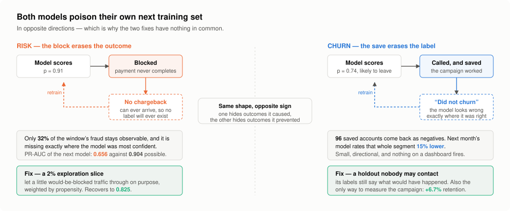

### Risk: blocking erases the outcome

Over days 150–200 the model blocked 246 transactions, 242 of them genuinely fraud. Those
never completed, so **no chargeback can ever arrive against them and no label will ever
exist**. Only 114 of the window's 356 frauds (32%) remain visible to the next retrain, and
they are missing precisely where the model is most confident.

This is the selective labels problem — the same structure Lakkaraju et al. documented in
bail decisions, where the outcome is only observed for the defendants the judge releases.

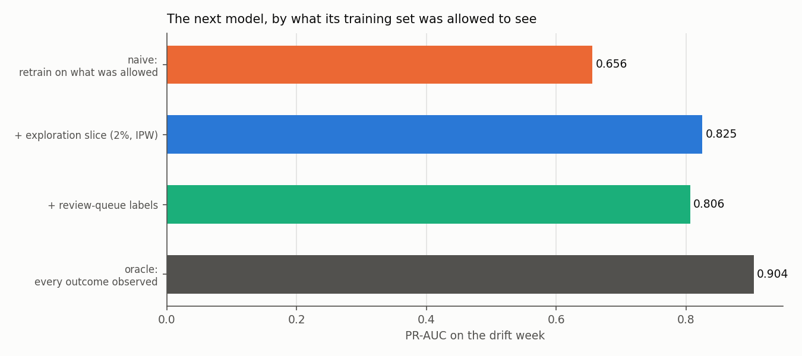

| Next training set | PR-AUC on the drift week | |
| :--- | ---: | :--- |
| naive: retrain on what was allowed | 0.656 | what happens by default |
| + a 2% exploration slice, inverse-propensity weighted | 0.825 | recovers 68% of the gap |
| + review-queue labels | 0.806 | **worse** than exploration alone |
| oracle: every outcome observed | 0.904 | impossible |

Two percent of blocked traffic — a small, deliberate, budgeted amount of fraud let through —
buys back two thirds of a quarter of a PR-AUC point. The third row is worth reading twice:
the simulated reviewers are wrong 12% of the time, and **a wrong label in the band the model
is least sure about does more damage than a missing one.** The article's "carefully" is
doing a lot of work.

One thing an exploration slice is *not*: a shadow challenger. A challenger in shadow mode
scores everything and decides nothing, which makes it a good way to compare two models on
the same traffic and no help at all here — it inherits the champion's censored labels,
because the champion is still the one deciding what completes.

### Churn: the intervention erases the label

The campaign saved 96 accounts and talked 27 into leaving. Both numbers are invisible in
production: the warehouse records only whether each account churned, with no note about why.

```
churn among the 4,437 called:    38.56%   95% CI [37.13%, 39.99%]
churn among the 3,192 held out:  45.27%   95% CI [43.54%, 47.00%]

incremental retention: +6.71% +/- 2.24% (significant at 95%)
```

That number does not exist without the holdout. The campaign's own reporting would say the
called accounts churned less than the book average — true, and meaningless, because they
were picked for being different.

Then the loop closes. The 96 saved accounts appear in the next training set as "did not
churn", so the model is punished for the prediction that caused the save. One round costs
0.012 PR-AUC, rates persuadable accounts 15.3% lower, and drops 8 saveable churners out of
tomorrow's top 200. Small, directional, and nothing on a dashboard fires — which is the
dangerous combination.

### Who can actually be talked out of it

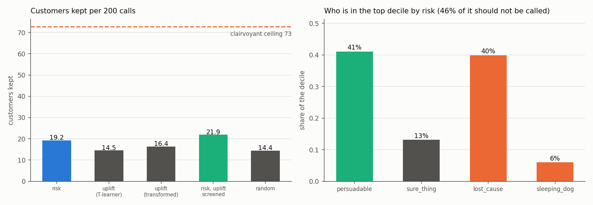

40% of the top risk decile cannot be saved, and 6% are people a call would push out the
door. That is not a modelling failure; it is how churn works. An account's reachability
decays as its decline progresses, so by the time a churn model is *confident* about someone,
the call that would have worked was six weeks ago.

**This result argues with the article.** See
[finding 2](findings.md#2-uplift-modelling-works-as-a-screen-not-as-a-ranker).

---

## 05. Monitoring on two clocks

```bash
.venv/bin/python 05_monitoring_two_clocks.py
```

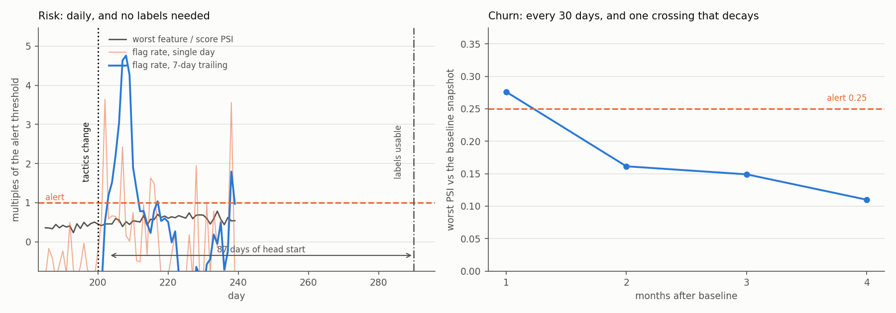

Same statistics on both sides, wired to different cadences and different thresholds.

### Risk, daily

The card-testing wave is 0.72% of traffic. Population PSI **never fires**, across all 55
monitored days — and that is not a bug in the monitor. A statistic computed over the whole
population cannot see a change that small, and lowering the threshold until it does would
page someone every week for reasons that are never attacks.

What does fire is the **flag rate**: the share of traffic scoring above the challenge band,
measured over a trailing week and compared against the four weeks before it.

```
first alert from population PSI:      never fired
first alert from the 7-day flag rate: day 203

  tactic changes                      day 200
  distribution monitor alerts         day 203
  chargebacks mature enough to score  day 290
```

**An 87-day head start**, with zero false alarms across the quiet days before the change.
See [finding 3](findings.md#3-monitor-the-flag-rate-not-only-the-feature-distributions) for
the two details that took several attempts to get right.

### Churn, monthly

The worst signal peaks at 0.276 against a 0.25 threshold, crossing once at month 1 on
`days_since_last_action` and settling back to 0.110 by month 4 with nobody doing anything
about it.

That is the shape of drift rather than an incident: one threshold crossing that decays on
its own. On a daily clock it would have been thirty pages. On a monthly clock it is a line
in a review.
